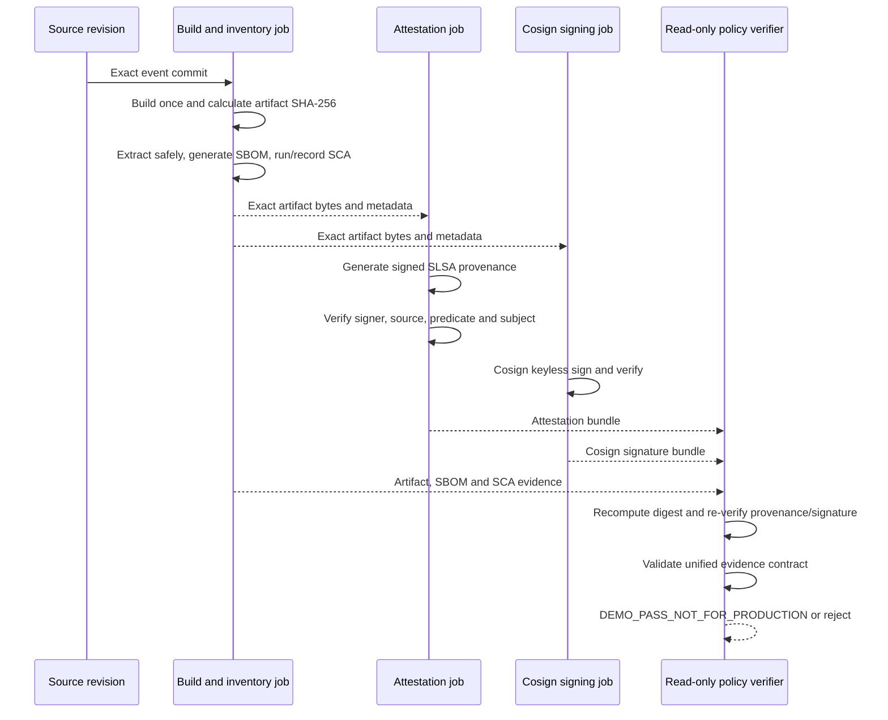

# Software Supply Chain Security Lab Pack

| Field | Value |
|---|---|
| Document ID | UAPPSEC-13-LAB-001 |
| Status | Draft specifications; Lab 01 executable synthetic baseline validated in CI; independent learner reproduction pending |
| Version | 0.7 |
| Owner | Unfiltered AppSec maintainers |
| Created | 2026-11-19 |
| Review due | 2027-02-19 |
| Scope | Repository, dependencies, CI/CD, SBOM, provenance, signing, containers, release and supplier security |
| Classification | Public |

## 1. Safety, authorization and lab rules

These labs use synthetic repositories, local registries, disposable containers, mock identities and test artifacts. They must not target public package registries with malicious uploads, real third-party repositories, production pipelines, live signing keys or customer systems.

Before execution:
- Obtain written authorization and define the exact repository, account, runner and network scope.
- Use a dedicated test organization/repository or local Git server.
- Use synthetic packages and package namespaces reserved for the lab.
- Use local registries and mock package endpoints for dependency-confusion and typosquatting exercises.
- Do not publish test packages to public registries.
- Do not use real production secrets, deploy keys, signing keys or cloud administrator credentials.
- Use test OIDC identities and disposable signing identities.
- Use isolated, disposable runners; do not execute untrusted test workflows on shared production runners.
- Restrict network egress to approved lab endpoints.
- Apply cost and runtime ceilings to hosted runners and cloud services.
- Preserve sanitized evidence and destroy test credentials, images, registries and artifacts after each lab.

A lab specification is not proof that an exercise has been implemented. Record exact versions, configuration, reproduction steps, expected results, evidence and cleanup. A reviewer must independently reproduce the exercise before it is marked validated.

## 2. Recommended lab environment

Minimum local workstation:
- Windows 11, macOS or Linux host with current patches.
- Git and a code editor.
- Docker Engine or Docker Desktop with resource limits.
- A disposable test repository and local working copy.
- Syft and Grype or equivalent SBOM/SCA tools.
- Cosign and a local/test signing configuration.
- A local OCI registry such as a disposable registry container.
- A local package registry or mock registry for package-source tests.
- A sample application with lockfiles and container definition.
- A local evidence directory with sanitized test outputs.

Optional hosted components:
- Dedicated GitHub organization and test repository.
- Dedicated self-hosted ephemeral runner or isolated hosted runner.
- A sandbox identity provider for OIDC.
- A test artifact repository.
- A disposable Kubernetes cluster for admission-policy exercises.

Do not use the main production repository as an attack target. A dedicated test repository may be based on a fork or synthetic starter project.

## 3. Synthetic reference application

Use a small application with:
- A frontend and backend.
- One direct dependency and several transitive dependencies.
- A lockfile.
- A Dockerfile or Containerfile.
- A simple CI workflow.
- A mock release artifact.
- A synthetic private package name such as lab-internal-parser.
- A second synthetic package with a similar name for typo-detection testing.
- A mock secret marker such as LAB_SECRET_DO_NOT_USE.
- Two synthetic environments: test and production-like lab.

No real credentials or production endpoints should exist in the reference project.

## 4. Evidence record

For each lab capture:
- Lab ID, operator, reviewer and authorization.
- Host OS, tool versions and environment topology.
- Repository, commit, workflow and package versions.
- Test identity, role and permissions.
- Preconditions and exact test steps.
- Sanitized command output and relevant logs.
- Artifact digest, SBOM and attestation identifiers where relevant.
- Expected versus actual behavior.
- Finding, impact, root cause and remediation.
- Retest result and reviewer.
- Cleanup verification and credential revocation.

## 5. Lab 01 — Supply-chain asset inventory and data-flow map

**Objective:** Build an inventory of a synthetic product's source, dependencies, build infrastructure and release artifacts.

**Prerequisites:** Synthetic application repository.

### Procedure

1. Identify repositories, branches, owners and release tags.
2. Identify manifests, lockfiles, vendored code and generated code.
3. Identify all direct and transitive dependencies.
4. Identify package registries, mirrors and download sources.
5. Identify workflow files, actions, plugins, runners and reusable workflows.
6. Identify build secrets, workload identities and environment permissions.
7. Identify output artifacts, image registries, signing identities and deployment targets.
8. Identify third-party suppliers and external services.
9. Draw trust boundaries from developer commit to deployed artifact.
10. Assign criticality, owner and required evidence to each component.

**Expected result:** A complete synthetic supply-chain inventory and trust-boundary diagram.

**Evidence:** Inventory, dependency graph, workflow map and risk register.

**Teardown:** No infrastructure required.

**Executable implementation:** [Lab 01 implementation pack](../../implementations/13-software-supply-chain-security/labs/lab-01-supply-chain-inventory/README.md). The synthetic fixture, schema contract, deterministic evidence generator and 24 positive/negative unit tests passed in [GitHub Actions run 45821145787](https://github.com/vimalpaul/Unfiltered-AppSec/actions/runs/45821145787). The workflow used Ubuntu 24.04 and Python 3.12.16, generated 12 assets across 10 categories, 11 relationships, 8 trust-boundary crossings and 5 risk scenarios, reproduced outputs byte-for-byte and verified their SHA-256 checksums. Retained evidence artifact [15117188140](https://github.com/vimalpaul/Unfiltered-AppSec/actions/runs/45821145787/artifacts/15117188140), digest `sha256:ba849ad477c11d6a9cc04c621bc4f2566a1b706e5f19e79bb965445ca1c7b231`, expires 2026-12-10. This validates the synthetic exercise and generator, not completeness of any real environment. Independent learner reproduction and Mermaid rendering remain pending.

## 6. Lab 02 — Branch protection and code-owner review

**Objective:** Confirm sensitive repository changes cannot bypass review policy.

**Prerequisites:** Dedicated test repository with configurable branch rules.

### Procedure

1. Create a protected default branch.
2. Configure pull-request requirement and independent approval.
3. Add code-owner rules for workflow, dependency and release files.
4. Require status checks from a trusted test workflow.
5. Attempt a direct push using a non-admin test identity.
6. Open a pull request changing a workflow file without code-owner review.
7. Change the pull request after approval and observe stale approval handling.
8. Attempt force-push or branch deletion with a non-privileged identity.
9. Review bypass permissions and audit logs.
10. Correct any control gap and repeat.

**Expected result:** Protected changes require authorized review and policy checks; bypass is limited and logged.

**Evidence:** Branch rules, CODEOWNERS, test identities and audit events.

**Teardown:** Remove test collaborators and delete the repository if no longer needed.

## 7. Lab 03 — Workflow permission minimization

**Objective:** Verify CI jobs receive only the repository and deployment permissions they require.

**Prerequisites:** Synthetic CI workflow and test repository.

### Procedure

1. Inspect default workflow token permissions.
2. Define explicit minimal permissions at workflow level.
3. Grant write permissions only to the job that needs them.
4. Separate test, package, sign and deploy jobs.
5. Run a test job and inspect the token's effective permissions without exposing the token value.
6. Attempt a harmless write operation from a read-only job.
7. Verify the operation is denied.
8. Verify untrusted pull-request workflows cannot access deployment environments or secrets.
9. Review third-party action permissions and outputs.
10. Record the permission matrix.

**Expected result:** Jobs cannot use privileges that are not explicitly granted.

**Evidence:** Workflow YAML, permission configuration and sanitized job logs.

**Teardown:** Revoke test tokens and remove temporary workflow.

## 8. Lab 04 — Third-party action pinning and workflow change review

**Objective:** Ensure third-party workflow code is pinned to immutable references and changes receive review.

**Prerequisites:** Test workflow containing a controlled action reference.

### Procedure

1. Inventory all external actions and reusable workflows.
2. Identify references using mutable tags or branches.
3. Replace lab references with verified full commit SHAs.
4. Record the upstream repository and release corresponding to each SHA.
5. Configure code-owner review for workflow files.
6. Change one action reference to a synthetic unapproved value.
7. Run the policy check.
8. Verify the change is rejected or requires an explicit exception.
9. Review update automation and release-note verification.
10. Document how pinned actions are updated safely.

**Expected result:** Workflow dependencies are immutable and reviewable; unapproved changes are blocked.

**Evidence:** Action inventory, pinned references and policy result.

**Teardown:** Restore approved workflow.

## 9. Lab 05 — Dependency confusion using a local mock registry

**Objective:** Demonstrate package-source ambiguity without interacting with public registries.

**Prerequisites:** Two local mock registries and synthetic package namespace.

### Procedure

1. Configure a private mock registry containing a synthetic internal package.
2. Configure a second local registry with a different package using the same synthetic name and a higher test version.
3. Configure the package manager's source priority and namespace mapping.
4. Resolve the package using the approved internal configuration.
5. Change the test configuration to an intentionally ambiguous source order.
6. Observe which registry supplies the package.
7. Verify the test package manager rejects or flags the unexpected source under the hardened policy.
8. Restore explicit namespace mapping and source priority.
9. Repeat dependency resolution and compare package hashes.
10. Document the risk and remediation for the actual package ecosystem.

**Expected result:** Internal package names resolve only from the approved registry and unexpected source substitution is detected.

**Evidence:** Local registry configuration, resolution logs and package hashes.

**Teardown:** Destroy both mock registries and delete synthetic packages.

## 10. Lab 06 — Typosquatting detection in a private test namespace

**Objective:** Test whether suspicious package-name similarity and publisher changes are reviewed.

**Prerequisites:** Local registry with two synthetic package names.

### Procedure

1. Create a benign synthetic package name in the local registry.
2. Create a second test package with a deliberately similar spelling.
3. Add the second name to a test manifest only in the lab branch.
4. Run package inventory and policy checks.
5. Inspect package source, maintainer identity, release history and install scripts.
6. Verify the suspicious package is flagged for review.
7. Configure an allowlist for the known-good package.
8. Confirm the similar package remains blocked until explicit review.
9. Record detection limitations and false-positive handling.
10. Repeat with a changed publisher identity for the known-good synthetic package.

**Expected result:** Unreviewed lookalike packages and unexpected publisher changes are identified before release.

**Evidence:** Package metadata, alert, review record and block decision.

**Teardown:** Delete both test packages and local registry data.

## 11. Lab 07 — Lockfile integrity and dependency drift

**Objective:** Verify that CI uses reviewed, deterministic dependency resolution.

**Prerequisites:** Synthetic application with manifest and lockfile.

### Procedure

1. Install dependencies using the project's documented lockfile-enforcing command.
2. Record resolved package versions and integrity hashes.
3. Modify a dependency declaration without updating the lockfile.
4. Run CI dependency installation.
5. Verify the mismatch causes a controlled failure or explicit update workflow.
6. Modify the lockfile to introduce an unexpected package version.
7. Review the dependency graph diff.
8. Run SCA and package-source validation.
9. Restore the approved lockfile.
10. Record the process for approving dependency updates.

**Expected result:** Builds use reviewed resolved versions and unreviewed dependency drift is detected.

**Evidence:** Manifest, lockfile diff, resolved graph and CI logs.

**Teardown:** Restore repository to baseline commit.

## 12. Lab 08 — SBOM generation and schema validation

**Objective:** Generate an SBOM for a synthetic release and validate it against the chosen format.

**Prerequisites:** Synthetic application and Syft or equivalent; CycloneDX or SPDX validator.

### Procedure

1. Build the synthetic application in a clean environment.
2. Generate an SBOM from the source/build directory.
3. Generate a second SBOM from the packaged artifact or container image where supported.
4. Compare component lists and identify differences.
5. Validate the selected CycloneDX or SPDX schema version.
6. Inspect direct and transitive dependency relationships.
7. Verify component identifiers, versions, hashes and licenses where available.
8. Identify missing vendored, generated or statically linked components.
9. Correct generation configuration and regenerate.
10. Bind the final SBOM to the artifact digest and release ID.

**Expected result:** The SBOM is schema-valid, release-associated and its coverage limitations are documented.

**Evidence:** SBOM files, validation output, artifact digest and coverage review.

**Teardown:** Remove generated artifacts and temporary build data.

## 13. Lab 09 — SBOM completeness and release comparison

**Objective:** Detect when the SBOM does not describe the actual artifact or changes between releases.

**Prerequisites:** Two synthetic builds with a controlled dependency change.

### Procedure

1. Generate SBOM for release A.
2. Add or update one synthetic dependency.
3. Build release B and generate its SBOM.
4. Compare components and dependency relationships.
5. Verify the new dependency appears in release B.
6. Remove a dependency and confirm it is absent where expected.
7. Compare SBOM component hashes with package and image contents.
8. Test an intentionally incomplete SBOM and verify release policy flags it.
9. Record the SBOM tool version and configuration.
10. Define a per-release SBOM retention process.

**Expected result:** SBOM changes accurately reflect release component changes; missing or inconsistent inventory is detected.

**Evidence:** Release A/B SBOMs, diff report and policy output.

**Teardown:** Delete synthetic releases and artifacts.

## 14. Lab 10 — Vulnerability triage and VEX decision quality

**Objective:** Assess a synthetic vulnerable dependency and produce a defensible vulnerability disposition.

**Prerequisites:** Local SCA tool and synthetic dependency/advisory fixture.

### Procedure

1. Add a test dependency version with a known lab advisory fixture.
2. Run SCA and record component identity and affected range.
3. Confirm package URL, version and advisory identifier.
4. Determine whether vulnerable functionality is present and reachable in the synthetic application.
5. Record exposure, configuration and compensating controls.
6. Create an affected or not-affected disposition only when supported by evidence.
7. Attempt a not-affected decision without technical justification.
8. Verify reviewer workflow rejects unsupported reasoning.
9. Upgrade to a fixed version in a separate branch.
10. Rebuild, rescan and confirm remediation.

**Expected result:** Vulnerability decisions are evidence-based, reviewable and tied to exact product/component versions.

**Evidence:** Scan output, dependency path, technical analysis, VEX or equivalent and retest.

**Teardown:** Remove fixture and restore baseline dependencies.

## 15. Lab 11 — Secrets exposure and workflow trust boundary

**Objective:** Confirm untrusted pull-request code cannot access privileged build secrets.

**Prerequisites:** Dedicated isolated test repository and synthetic marker secret only.

### Procedure

1. Create a synthetic secret marker with no external value or privilege.
2. Store it only in a dedicated lab environment.
3. Configure a workflow triggered by a trusted branch.
4. Configure a separate untrusted pull-request workflow.
5. Verify the untrusted workflow receives no secret context or privileged token.
6. Review workflow event type and permission model.
7. Simulate an unsafe workflow configuration in a disposable branch without printing the marker.
8. Verify policy review detects the dangerous event/secret combination.
9. Remove the synthetic secret and inspect logs for accidental exposure.
10. Document required event separation and environment protection.

**Expected result:** Untrusted contribution workflows cannot access privileged secrets; no secret value is emitted to logs.

**Evidence:** Workflow configuration, environment permissions and sanitized audit output.

**Teardown:** Delete the synthetic secret and workflow run artifacts.

## 16. Lab 12 — Ephemeral runner and cross-job isolation

**Objective:** Verify runner state does not persist across mutually untrusted jobs.

**Prerequisites:** Dedicated disposable runner or local ephemeral runner simulation.

### Procedure

1. Record runner image, version, installed tools and permissions.
2. Execute a benign job that writes a synthetic marker to its workspace.
3. Terminate the runner or job environment.
4. Start a new job on a fresh runner.
5. Verify the previous workspace marker and temporary credentials are unavailable.
6. Inspect cache sharing and artifact transfer settings.
7. Verify caches do not contain credentials or untrusted executable state.
8. Test egress policy against a local mock endpoint.
9. Confirm runner teardown and image provenance.
10. Record exceptions for any persistent runner pool.

**Expected result:** Jobs do not inherit untrusted writable state or credentials from prior jobs.

**Evidence:** Runner lifecycle logs, workspace checks, cache policy and egress logs.

**Teardown:** Destroy runner and remove test cache.

## 17. Lab 13 — OIDC workload identity trust conditions

**Objective:** Verify that a CI workload receives short-lived credentials only for an approved repository, ref, workflow and audience.

**Prerequisites:** Sandbox OIDC identity provider and test cloud/resource identity.

### Procedure

1. Configure a test federated identity trust relationship.
2. Bind it to the exact test repository and approved branch/environment.
3. Configure the expected token audience.
4. Request a token from the approved test workflow.
5. Verify claims and short-lived credential issuance without logging token contents.
6. Attempt from a different repository or unapproved ref.
7. Attempt with a wrong audience or workflow identity.
8. Verify each unauthorized request is denied.
9. Confirm the identity has only the intended resource permissions.
10. Revoke the federation trust and verify further token exchange fails.

**Expected result:** Workload identity is constrained by subject, issuer, audience and resource scope.

**Evidence:** Redacted claims, trust policy and allow/deny logs.

**Teardown:** Delete test federated identity and revoke issued credentials.

## 18. Lab 14 — Build provenance generation

**Objective:** Generate provenance for a controlled artifact and verify its source/build claims.

**Prerequisites:** Synthetic CI pipeline and supported SLSA/in-toto provenance tooling.

### Procedure

1. Create a clean source commit and record its immutable revision.
2. Configure a trusted builder identity and workflow.
3. Build a synthetic artifact with declared dependencies.
4. Generate provenance using the supported predicate and schema version.
5. Inspect subject digest, source repository/revision, builder identity and build definition.
6. Verify the provenance is authenticated or signed by the expected identity.
7. Compare provenance materials with the lockfile and workflow inputs.
8. Alter a test artifact and compare digests.
9. Verify provenance no longer matches the modified artifact.
10. Record what SLSA requirements are met and what remains unimplemented.

**Expected result:** Provenance binds the exact artifact digest to verifiable source and builder information.

**Evidence:** Provenance statement, signature/bundle, source commit and artifact digest.

**Teardown:** Delete test artifacts and signing material.

## 19. Lab 15 — Artifact signing and signature verification with Cosign

**Objective:** Sign and verify a synthetic release artifact using a disposable signing identity.

**Prerequisites:** Cosign, test artifact and test key or approved sandbox keyless identity. The repository includes a keyless synthetic signing exercise at [Chapter 13 Cosign implementation](../../implementations/13-software-supply-chain-security/signing/README.md); use its successful workflow as a reproducible starter, not as independent lab validation.

### Procedure

1. Create a synthetic file and calculate its digest.
2. Configure an explicitly lab-scoped signing identity.
3. Sign the artifact or its digest using the selected Cosign mode.
4. Preserve the signature bundle and verification metadata.
5. Verify using the expected signer identity and issuer.
6. Verify using a different expected identity and confirm rejection.
7. Inspect transparency/verification evidence where the selected mode supports it.
8. Record key or identity custody and revocation assumptions.
9. Repeat with a new artifact digest.
10. Document production trust policy separately from the lab identity.

**Expected result:** Valid signatures verify only for the expected artifact digest and trusted signer identity.

**Evidence:** Artifact digest, signature bundle and successful/failed verification output.

**Teardown:** Revoke/delete lab key material and remove artifacts.

## 20. Lab 16 — Artifact tampering and digest mismatch

**Objective:** Confirm that a modified artifact cannot pass signature/provenance verification.

**Prerequisites:** Completed signing/provenance lab artifacts.

### Procedure

1. Select the signed synthetic artifact.
2. Verify its baseline digest and signature.
3. Copy it to a separate tamper-test location.
4. Modify one byte or append a harmless marker to the copy.
5. Recalculate the digest.
6. Run signature verification against the modified copy.
7. Run provenance subject verification against the modified copy.
8. Confirm both checks fail.
9. Attempt to substitute a mutable tag for the original immutable digest in the test registry.
10. Verify deployment policy rejects the mismatch.

**Expected result:** Any content change produces a different digest and is rejected by signature/provenance verification.

**Evidence:** Original and modified digests, verification outputs and policy decision.

**Teardown:** Delete modified copy and restore registry state.

## 21. Lab 17 — Container image supply-chain assurance

**Objective:** Build, inventory, scan, sign and verify a synthetic container image.

**Prerequisites:** Docker/Podman, local registry, Syft/Trivy/Grype and Cosign.

### Procedure

1. Review the container definition and base image source.
2. Pin the base image by digest in the test branch.
3. Build the image using a clean builder.
4. Generate an image SBOM and scan OS/application packages.
5. Inspect user, capabilities, filesystem, exposed ports and image layers.
6. Sign the image digest with a test identity.
7. Verify the image signature and expected signer.
8. Push to a local registry and pull by digest.
9. Verify the pulled digest and signature.
10. Attempt to use a different image or mutable tag and confirm policy detects mismatch.

**Expected result:** The image is traceable, scanned, signed and consumed by immutable digest.

**Evidence:** Container definition, image digest, SBOM, scan, signature and verification logs.

**Teardown:** Remove local image, registry data and signing identity.

## 22. Lab 18 — IaC and deployment artifact policy

**Objective:** Detect insecure infrastructure configuration and unpinned deployment inputs before apply.

**Prerequisites:** Synthetic Terraform, Bicep, Helm or Kubernetes manifest and policy-as-code tool.

### Procedure

1. Create a baseline deployment configuration with safe defaults.
2. Run syntax, static and policy validation.
3. Introduce a synthetic public exposure or excessive permission in the test branch.
4. Run policy checks and record the violation.
5. Pin a module/provider/chart dependency to an approved version.
6. Change it to a mutable or unapproved source and rerun policy.
7. Verify plan and apply identities are separate in the lab design.
8. Confirm no real cloud apply occurs; use plan-only or local validation.
9. Record exception process for legitimate deviations.
10. Restore the safe configuration and rerun.

**Expected result:** Unsafe exposure, excessive privilege and unpinned deployment dependencies are identified before deployment.

**Evidence:** Configuration diff, policy output and review record.

**Teardown:** Delete temporary state and test files.

## 23. Lab 19 — Open-source license and component governance

**Objective:** Demonstrate a controlled component intake and license review workflow.

**Prerequisites:** Synthetic dependency set with different license metadata.

### Procedure

1. Generate a component inventory and license report.
2. Identify direct and transitive dependencies.
3. Verify license identifiers and source metadata.
4. Flag a synthetic component with a license requiring legal review.
5. Flag a component with missing or conflicting license metadata.
6. Route both to the defined legal/compliance review process.
7. Record copyright notice and distribution obligations where known.
8. Verify automated scanner output is not treated as a legal conclusion.
9. Record approved and rejected component decisions.
10. Add the approved license policy to the release evidence package.

**Expected result:** License uncertainty is visible and reviewed before distribution; no automated tool is treated as legal authority.

**Evidence:** SBOM, license report, review record and exception.

**Teardown:** Remove test dependency fixtures.

## 24. Lab 20 — AI model and dataset provenance

**Objective:** Verify model and dataset artifacts are inventoried, hashed, licensed and traceable before use.

**Prerequisites:** Synthetic or openly licensed small model/dataset artifacts in a local test environment.

### Procedure

1. Select a small permitted test model or synthetic model artifact.
2. Record publisher, source, version, license and intended use.
3. Calculate cryptographic digest and record file metadata.
4. Record tokenizer, adapter, dataset and evaluation-set dependencies.
5. Inspect loader configuration and disable unneeded remote code execution.
6. Verify artifact hash after download or transfer.
7. Change a copy and verify hash mismatch detection.
8. Record model/data lineage in the selected BOM or inventory format.
9. Verify unapproved or mismatched assets are rejected by the test gate.
10. Coordinate the findings with the AI security controls in Chapter 12.

**Expected result:** AI assets have traceable origin, integrity, license and dependency metadata.

**Evidence:** Asset inventory, hashes, license review and policy decision.

**Teardown:** Delete model/dataset copies and caches.

## 25. Lab 21 — Supplier security assessment

**Objective:** Assess a synthetic critical supplier using evidence-based supply-chain questions.

**Prerequisites:** Synthetic supplier profile and sample assurance documents.

### Procedure

1. Assign supplier criticality based on privilege, data access, product dependency and substitutability.
2. Request development lifecycle, access, vulnerability and incident-response evidence.
3. Request SBOM, provenance and signing capabilities for supplied software.
4. Review subprocessor and upstream dependency transparency.
5. Review support, end-of-life and security notification commitments.
6. Record evidence gaps and contradictory answers.
7. Define technical validation or contractual follow-up.
8. Create a residual risk and remediation plan.
9. Define reassessment cadence and incident contact.
10. Record approval, conditional approval or rejection.

**Expected result:** Supplier acceptance is risk-based, evidence-backed and has named owners and follow-up actions.

**Evidence:** Supplier scorecard, evidence register, decision and action plan.

**Teardown:** Delete synthetic supplier records.

## 26. Lab 22 — Compromised dependency incident tabletop

**Objective:** Practice response when a supplier announces a compromised package release.

**Scenario:** A synthetic package used by two test products is reported compromised. Affected versions and malicious release details are provided in the exercise inject.

### Procedure

1. Assign incident commander, AppSec, engineering, DevOps, procurement, legal and communications roles.
2. Identify affected package coordinates, versions and source registries.
3. Use SBOMs to identify affected products and deployed releases.
4. Freeze dependency updates and quarantine the suspect package in the mock registry.
5. Identify build runs and artifacts that consumed the package.
6. Preserve package archive, metadata, workflow logs and artifact digests.
7. Determine whether the affected version reached production-like deployment.
8. Rebuild from known-good dependencies and trusted runners.
9. Generate new SBOM, provenance and signatures.
10. Validate replacement artifacts and document customer/supplier notification decisions.

**Expected result:** Team can identify exposure, contain updates, rebuild and prove the replacement artifact's lineage.

**Evidence:** Timeline, affected-product matrix, package quarantine, rebuild and release evidence.

**Teardown:** Restore mock registry and remove incident artifacts.

## 27. Lab 23 — Signing identity compromise and revocation

**Objective:** Validate containment when a test signing identity is suspected compromised.

**Prerequisites:** Disposable signing identity and test artifact repository.

### Procedure

1. Create and register a lab-only signing identity.
2. Sign a synthetic artifact and verify it under the lab trust policy.
3. Simulate a compromise notification for that identity.
4. Disable or revoke the identity according to the test mechanism.
5. Attempt to sign a new artifact and verify rejection.
6. Review how previously signed artifacts are identified and re-evaluated.
7. Update trust policy to reject the compromised identity.
8. Re-sign a known-good artifact with a replacement identity.
9. Verify the new signature and provenance.
10. Record consumer notification and cache invalidation requirements.

**Expected result:** Compromised signing identity is revoked, future use is blocked and affected artifacts are identified for re-verification.

**Evidence:** Identity record, revocation event, failed signature attempt and replacement verification.

**Teardown:** Delete test identity and revoke remaining credentials.

## 28. Lab 24 — Release evidence gate and deployment verification

**Objective:** Verify production-like release promotion requires complete evidence bound to one immutable artifact.

**Prerequisites:** Synthetic release package and policy-as-code gate.

### Procedure

1. Create a release candidate with artifact digest, SBOM, provenance, signature and test results.
2. Bind all evidence to the same release ID and artifact digest.
3. Run the release evidence policy.
4. Remove one required evidence item and rerun.
5. Substitute an SBOM or provenance statement from a different digest.
6. Attempt to use an unapproved signer identity.
7. Verify each incomplete or mismatched case is rejected.
8. Restore the correct evidence package.
9. Record approval and deploy only to a disposable environment.
10. Confirm deployed digest matches the approved artifact digest.

**Expected result:** Only the approved artifact with complete, matching and verified evidence is promoted.

**Evidence:** Policy version, release manifest, evidence bundle, approval and deployed digest.

**Teardown:** Destroy disposable environment and release artifacts.

## 29. Lab 25 — End-to-end supply-chain compromise exercise

**Objective:** Test the complete preventive, detective and recovery chain across source, build, artifact and release.

**Scenario:** A synthetic untrusted workflow change attempts to access a test secret, then a test package mismatch is introduced, and a release candidate is presented with missing provenance.

### Procedure

1. Confirm exercise authorization, roles and containment boundaries.
2. Create a baseline source commit and verified release artifact.
3. Introduce a controlled workflow policy violation in a separate lab branch.
4. Verify branch/review and workflow policy detects the change.
5. Introduce a synthetic dependency-source mismatch in the mock registry.
6. Verify dependency policy blocks or quarantines the package.
7. Attempt release promotion without valid provenance.
8. Verify release policy blocks the candidate.
9. Trigger the incident response process and preserve all logs and evidence.
10. Revert to known-good source and dependency state.
11. Rebuild on a trusted ephemeral runner.
12. Generate SBOM and authenticated provenance.
13. Sign and verify the replacement artifact.
14. Promote to a disposable environment and compare deployed digest.
15. Conduct a lessons-learned review and update controls.

**Expected result:** Multiple independent controls prevent a test supply-chain compromise from reaching the release environment; incident response restores a verifiable trusted release.

**Evidence:** Full timeline, branch policy, dependency logs, runner records, SBOM, provenance, signature, release gate and deployment digest.

**Teardown:** Revoke all test identities, delete mock registry and runners, remove artifacts and confirm no test secrets remain.

## 30. Lab 26 — SLSA v1.2 Source track evidence

**Objective:** Assess whether a test repository can demonstrate source-track requirements for revision identity, history, technical controls and two-party review.

**Prerequisites:** Dedicated test repository with protected branch rules, code-owner policy and audit logs.

### Procedure

1. Pin SLSA v1.2 and identify the Source track requirements for L1 through L4.
2. Record the repository's stable identifier and an immutable source revision.
3. Verify that source revisions are uniquely identifiable and the change history is retained.
4. Configure protected branch rules, restricted administrative access and immutable release tags where supported.
5. Generate or collect source provenance evidence for a new test revision.
6. Verify that the evidence identifies the revision, contributors, parent revision and relevant change-management controls.
7. Configure a technical control such as mandatory status checks and code-owner approval.
8. Attempt a protected-branch update that does not satisfy the technical control.
9. Configure two independent trusted reviewers for the protected branch.
10. Attempt a change with only one approval and verify the source control system blocks it.
11. Inspect administrative bypass paths and record how they are controlled and audited.
12. Map evidence to each SLSA Source level separately; record the highest level fully evidenced and all gaps.

**Expected result:** Source revision identity, history, provenance, technical enforcement and two-party review are evidenced without conflating the Source and Build tracks.

**Evidence:** Repository policy, revision identifiers, source provenance, review records, bypass logs and level assessment.

**Teardown:** Restore baseline branch policy and remove test reviewers.

## 31. Lab 27 — SLSA v1.2 Build track and hardened builder isolation

**Objective:** Assess build provenance, hosted-builder trust, signature verification and Build L3 isolation requirements.

**Prerequisites:** Dedicated hosted or disposable CI builder, synthetic artifact and lab signing identity. The repository includes an executable synthetic GitHub Actions exercise at [SLSA provenance implementation](../../implementations/13-software-supply-chain-security/provenance/README.md); use its run as a starting evidence sample, not as independent lab validation.

### Procedure

1. Pin SLSA v1.2 and read the normative Build L1, L2 and L3 requirements.
2. Build a synthetic artifact with a consistent documented workflow.
3. Generate provenance containing the artifact digest, build type, builder identity and top-level inputs.
4. Verify provenance exists and is distributed with the artifact.
5. Move the test to a hosted build platform that can generate and sign provenance.
6. Verify provenance authenticity against the expected signer and builder identity.
7. Inspect the builder's isolation model and trusted control-plane boundary.
8. Run two controlled jobs and verify they cannot influence each other's writable state.
9. Verify the user-defined build steps cannot read or modify provenance-signing secrets.
10. Verify untrusted pull-request code cannot access signing credentials or production deployment identity.
11. Attempt to alter an artifact after the build and verify digest/provenance checks fail.
12. Record which Build track level is fully supported by evidence and which requirements remain unmet.

**Expected result:** Build provenance is tied to the artifact digest and expected builder; higher-level claims are made only when the hosted platform and isolation requirements are evidenced.

**Evidence:** Provenance statement, signature bundle, builder documentation, isolation test, secret-access policy and digest verification. For the repository exercise, retain the workflow run, signed bundle, signer-workflow verification output, exact source commit and negative tamper/wrong-signer test logs.

**Teardown:** Revoke lab signing identity and destroy builder resources.

## 32. Lab 28 — Unified release assurance and evidence consistency

**Lab ID:** SSC-LAB-028  
**Related controls:** SSC-C-007, SSC-C-008, SSC-C-011, SSC-C-012, SSC-C-013  
**Related tests:** SSC-T-017, SSC-T-018, SSC-T-019, SSC-T-029, SSC-T-036, SSC-T-037, SSC-T-038, SSC-T-039, SSC-T-040, SSC-T-041  
**Related detections:** SSC-D-012, SSC-D-013, SSC-D-014, SSC-D-022, SSC-D-029, SSC-D-030  
**Difficulty:** Advanced  
**Environment:** GitHub Actions, GitHub artifact attestations, GitHub CLI, Syft, Grype, Cosign and Python 3.10+  
**Classification:** Synthetic training exercise; no production release or deployment

### 32.1 Objective

Demonstrate that individually valid SBOM, SCA, SLSA provenance and Cosign evidence are not sufficient unless they all refer to the same immutable artifact and satisfy one consistent trust policy. The learner will execute the repository's unified workflow, inspect the evidence contract, deliberately test invalid combinations and explain why the policy decision is fail-closed.

### 32.2 Learning outcomes

On completion, the learner must be able to:

1. Explain the difference between artifact digest, SBOM document digest, SCA report digest, provenance bundle digest and signature bundle digest.
2. Trace how one immutable artifact moves across build, inventory, scan, attestation, signing and final verification trust domains.
3. Verify that provenance and signature identities are constrained to the expected repository, workflow, ref, revision and OIDC issuer.
4. Detect evidence splicing, subject mismatch, missing evidence, cross-run evidence and false clean claims caused by empty inventories.
5. Interpret a demonstration-only policy result without misrepresenting it as production release approval or a SLSA level claim.

### 32.3 Authorization, scope and stop conditions

This lab operates only in the public Unfiltered-AppSec repository and its GitHub-hosted Actions workflow using a deterministic synthetic archive. Do not substitute a customer application, production artifact, private package, real signing key, production cloud identity or deployment environment.

Stop the exercise if:
- the workflow requests production secrets or deployment permissions;
- an unexpected repository, branch, signer identity or OIDC issuer is observed;
- the artifact is not labelled as a synthetic training fixture;
- the workflow attempts to deploy, publish a production release or modify external infrastructure;
- evidence cannot be tied to the exact workflow run and source revision.

### 32.4 Roles and responsibilities

| Role | Responsibility |
|---|---|
| Learner / release engineer | Trigger the workflow, collect evidence and perform the consistency review |
| Build platform | Build once, inventory and scan the exact synthetic artifact |
| Attestation job | Generate and verify GitHub-signed provenance |
| Signing job | Generate and verify the Cosign keyless signature |
| Policy verifier | Re-download evidence, repeat cryptographic checks and make the policy decision |
| Instructor / reviewer | Review trust boundaries, negative tests and evidence interpretation |

### 32.5 Prerequisites and pinned components

- Repository access with permission to run GitHub Actions.
- GitHub-hosted Ubuntu runner.
- Python 3.10 or later.
- Syft 1.57.1, downloaded with the repository-pinned SHA-256.
- Grype 0.122.1, downloaded with the repository-pinned SHA-256.
- Cosign v3.1.6 and its pinned Sigstore release bundle.
- GitHub CLI with `gh attestation verify` support.
- Pinned GitHub Actions referenced in the workflow by full commit SHA.

The versions above are the repository's implementation pins at the time of this lab. Re-check official releases and digest provenance before updating pins.

### 32.6 Architecture and data flow

### 32.7 Setup and execution

1. Open the repository's [Unified Release Assurance workflow](../../.github/workflows/unified-release-assurance.yml).
2. Confirm the target ref is `main`. The workflow intentionally runs its signing and attestation jobs only for the protected target ref; the current repository ruleset state must be checked separately.
3. Trigger the workflow through `workflow_dispatch` or make an approved change to one of the workflow's watched implementation paths.
4. Open the resulting Actions run and confirm that the build, attestation, signing and final policy jobs belong to the same run ID and attempt.
5. Inspect the build job. Confirm it fetched the exact event commit, built the deterministic synthetic archive once and calculated its SHA-256.
6. Inspect the inventory job output. Confirm Syft generated CycloneDX 1.7 and SPDX 2.3 from the safely extracted release archive and the repository validator checked their required structure.
7. Inspect the SCA disposition. If package records exist, confirm Grype ran and the report validator passed. If there are no package records, confirm the record says `not_run_no_package_records`, the match count is null and the disposition is `not_evaluated_no_package_records`. Do not interpret this as zero vulnerabilities.
8. Inspect the attestation job. Confirm it received the artifact from the build job, checked the metadata and digest, generated GitHub-signed SLSA provenance and verified the expected signer workflow, repository, source ref, source digest, issuer and predicate.
9. Inspect the signing job. Confirm it verified the pinned Cosign release binary and bundle, signed the same artifact and verified the certificate identity, issuer, repository, source ref, source SHA and trigger.
10. Inspect the final policy job. Confirm it downloads the artifact and evidence, repeats GitHub attestation and Cosign verification, runs the negative cryptographic tests, creates the manifest and invokes the policy engine.
11. Confirm the only acceptable successful result is `DEMO_PASS_NOT_FOR_PRODUCTION` and `promotion_authorized: false`.
12. Download the retained `ura-release-evidence` artifact and preserve its manifest, decision, artifact, SBOM, SCA disposition, attestation bundle and Cosign bundle for review.

### 32.8 Evidence consistency checks

| Check | What to inspect | Pass condition |
|---|---|---|
| Artifact identity | SHA-256 in build metadata, manifest and final downloaded artifact | All identical |
| SBOM binding | SBOM record subject digest and generation scope | Exact artifact digest and extracted-artifact scope |
| SCA linkage | SCA subject digest and SBOM document digest | Both point to the exact artifact and SBOM document |
| SCA database | `grype db status` record, schema, build time, validity and status-file SHA-256 | Status is valid, evidence file digest matches, database age is at most 72 hours |
| Provenance | GitHub CLI verification result and attestation bundle | Expected signer workflow, issuer, source revision, predicate and artifact subject |
| Signature | Cosign verification and bundle | Exact artifact, certificate identity and OIDC issuer |
| Run consistency | Run ID and attempt in every evidence record | All evidence from the same workflow execution |
| Policy outcome | Release decision JSON | Demonstration pass only; no production promotion |

### 32.9 Negative testing

The integrated workflow executes cryptographic negative tests. The policy unit tests provide additional deterministic cases. Review the following scenarios:

| Scenario | Controlled mutation | Expected result | Test reference |
|---|---|---|---|
| Artifact tampering | Append bytes after signing/attestation | GitHub attestation and Cosign verification reject | SSC-T-017 |
| Untrusted provenance workflow | Supply a non-allow-listed signer workflow | GitHub CLI verification rejects | SSC-T-019 |
| Untrusted Cosign identity | Supply an incorrect certificate identity | Cosign verification rejects | SSC-T-019 |
| Wrong OIDC issuer | Supply an untrusted issuer | Cosign verification rejects | SSC-T-019 |
| Missing SBOM | Remove the SBOM record | Policy engine rejects | SSC-T-038 |
| Missing provenance/signature | Remove required evidence | Policy engine rejects | SSC-T-038 |
| SBOM subject mismatch | Replace SBOM subject digest | Policy engine rejects | SSC-T-036 |
| SCA-to-SBOM mismatch | Replace the SBOM document digest in SCA record | Policy engine rejects | SSC-T-037 |
| Cross-run evidence | Change one evidence run ID or attempt | Policy engine rejects | SSC-T-039 |
| False clean inventory | Mark no-package state as zero vulnerabilities | Policy engine rejects | SSC-T-040 |
| Invalid or stale Grype DB | Mark database invalid or use a build timestamp older than 72 hours | Policy engine rejects | SSC-T-041 |
| DB status tampering | Modify the retained Grype status file without updating its recorded digest | Policy engine rejects | SSC-T-041 |
| Evidence tampering | Modify a retained evidence file without updating its digest | Policy engine rejects | SSC-T-038 |

The unit tests are not a substitute for the real GitHub and Cosign cryptographic negative tests. Both layers are required.

### 32.10 Expected results and troubleshooting

A successful workflow demonstrates that the synthetic artifact, SBOM, SCA disposition, provenance and signature have a consistent evidence relationship. It does not establish production security or compliance.

| Symptom | Likely cause | Action |
|---|---|---|
| GitHub attestation verification fails | Wrong source ref, signer workflow, issuer, predicate or subject | Inspect verified statement and workflow claims; do not relax identity constraints to force a pass |
| Cosign verification fails | Wrong bundle, artifact bytes, certificate identity or issuer | Recompute artifact digest and inspect certificate claims |
| SBOM structural check fails | Tool output format/version changed or artifact inventory issue | Inspect Syft version and JSON fields; update pins only after review |
| SCA report validation fails | Scanner report format changed or report incomplete | Inspect Grype descriptor, database status and report structure |
| Policy rejects cross-run evidence | Artifacts from different run attempts were mixed | Re-download all artifacts from the same workflow run |
| Empty inventory is reported | No recognized package records in the synthetic archive | Preserve the explicit not-evaluated disposition; do not manufacture a clean scan |
| Evidence file digest mismatch | File changed, truncated or path points to wrong object | Re-download and verify artifact retention and evidence path |

### 32.11 Remediation and retest

1. Do not weaken signer, issuer, source or digest constraints to clear a failed test.
2. Identify the exact failed invariant and preserve the failing evidence.
3. Correct the build, evidence-generation or policy logic in a reviewed change.
4. Re-run the full workflow from a single source revision.
5. Confirm all positive checks and all negative tests still behave as expected.
6. Record the new workflow run, source SHA, artifact digest, evidence artifact ID and decision.
7. Keep the previous failed run as an audit record; do not overwrite its evidence.

### 32.12 Teardown and evidence retention

- No persistent lab infrastructure is created.
- Retain the workflow run URL, source SHA, artifact digest, release manifest, decision JSON, SBOMs, SCA disposition, provenance bundle, Cosign bundle and test logs.
- Confirm temporary workflow artifacts expire under the configured retention period.
- Do not copy the synthetic signer identity or test evidence into a production trust policy without a separate threat model and approval.

### 32.13 Assessment rubric

| Criterion | Points |
|---|---:|
| Explains trust domains and least-privilege job separation | 15 |
| Correctly distinguishes artifact and evidence digests | 15 |
| Verifies SBOM subject and SCA-to-SBOM linkage | 15 |
| Interprets SLSA and Cosign identity verification | 15 |
| Explains empty-inventory semantics correctly | 10 |
| Demonstrates missing, tampered and mismatched evidence rejection | 15 |
| Explains why a demo pass is not production authorization | 10 |
| Preserves complete and traceable evidence | 5 |
| **Total** | **100** |

Suggested interpretation: 90–100 strong independent engineering; 75–89 competent with review; 60–74 guided remediation required; below 60 repeat the exercise. These are educational thresholds, not a certification.

### 32.14 Instructor review checklist

- Was the lab run only against the synthetic training fixture?
- Did the build job lack OIDC, attestation and deployment permissions?
- Was one artifact built and transferred without rebuilding?
- Was the SBOM generated from the release artifact contents?
- Was the SCA report bound to the exact SBOM digest?
- Was an empty package inventory treated as not evaluated?
- Were provenance and Cosign verification repeated in the final policy job?
- Were signer, issuer, repository, ref, source revision and subject digest constrained?
- Did tampering, wrong identity and wrong issuer tests reject?
- Did missing, mismatched and cross-run evidence tests reject?
- Did the final decision explicitly deny production promotion?
- Were original evidence files and their digests retained?
- Were limitations and outstanding production controls recorded?

## 33. Assessment rubric

| Criterion | Points |
|---|---:|
| Supply-chain inventory and threat model | 10 |
| Repository, identity and workflow controls | 15 |
| Dependency and package-source security | 15 |
| SBOM, SCA and VEX quality | 15 |
| Build isolation, secrets and workload identity | 15 |
| Provenance, signing and verification | 15 |
| Container, IaC and release controls | 5 |
| Supplier assurance, incident response and evidence | 10 |
| **Total** | **100** |

Suggested training interpretation: 90–100 strong independent engineering; 75–89 competent with review; 60–74 guided remediation required; below 60 repeat the exercises. These are educational thresholds, not a certification.

## 34. Instructor review checklist

- Was the scope authorized and isolated?
- Were all repositories, dependencies, registries, workflows and artifacts inventoried?
- Were privileged identities and branch protections reviewed?
- Were workflow files treated as privileged code?
- Were third-party actions and dependencies pinned?
- Were private package namespaces protected from public registry confusion?
- Were dependency lockfiles and resolved graphs validated?
- Was SBOM generated from the release artifact and schema-validated?
- Were vulnerabilities mapped to exact package coordinates and affected versions?
- Were VEX decisions technically justified and reviewed?
- Were untrusted PRs separated from privileged secrets and environments?
- Were build runners ephemeral, isolated and egress-restricted?
- Were workload identity claims constrained by issuer, subject and audience?
- Was provenance authenticated and bound to the exact artifact digest?
- Were artifact signatures verified against an explicit trust policy?
- Did tampering and wrong-signer tests fail?
- Were container images pinned, inventoried, scanned and signed?
- Were IaC and deployment artifacts reviewed and policy-checked?
- Were licenses and supplier risks routed to appropriate owners?
- Were AI models and datasets inventoried and hash-verified?
- Was a supplier compromise and signing identity incident rehearsed?
- Was the release evidence gate tested with missing and mismatched evidence?
- Were all test credentials, registries, runners and artifacts removed?

## 35. References

1. NIST SP 800-218 SSDF v1.1: https://csrc.nist.gov/pubs/sp/800/218/final
2. SLSA v1.2 specification: https://slsa.dev/spec/v1.2/
3. SLSA v1.2 Source track: https://slsa.dev/spec/v1.2/source-requirements
4. SLSA v1.2 Build track: https://slsa.dev/spec/v1.2/build-requirements
5. in-toto: https://in-toto.io/
6. SPDX specification: https://spdx.github.io/spdx-spec/v3.0.1/
7. CycloneDX 1.7: https://cyclonedx.org/specification/overview/
8. CISA 2026 Minimum Elements for an SBOM announcement: https://content.govdelivery.com/accounts/USDHSCISA/bulletins/422a7eb
9. Sigstore: https://docs.sigstore.dev/
10. Cosign quickstart: https://docs.sigstore.dev/quickstart/quickstart-cosign/
11. OpenSSF Scorecard: https://scorecard.dev/
12. OSV: https://osv.dev/
13. OSV-Scanner: https://google.github.io/osv-scanner/
14. OWASP Dependency-Track: https://dependencytrack.org/
15. Syft: https://github.com/anchore/syft
16. Grype: https://github.com/anchore/grype
17. NIST CSF 2.0: https://www.nist.gov/cyberframework
18. ISO/IEC 27001: https://www.iso.org/standard/27001
19. ISO/IEC 27036: https://www.iso.org/standard/82905.html
20. PCI DSS: https://www.pcisecuritystandards.org/document_library/
21. EU Cyber Resilience Act: https://eur-lex.europa.eu/eli/reg/2024/2847/oj
22. OWASP SAMM: https://owaspsamm.org/

## 36. Revision history

| Version | Date | Change |
|---|---|---|
| 0.1 | 2026-11-19 | Initial software supply-chain security lab specifications |
| 0.2 | 2026-11-19 | Add SLSA v1.2 Source and Build track assessment labs |
| 0.3 | 2026-11-26 | Add Lab 28 for unified release evidence assurance, digest consistency and fail-closed verification |
| 0.4 | 2026-11-26 | Expand Lab 28 with integrated workflow, run-attempt binding, end-to-end negative cases and evidence retention procedure |
| 0.5 | 2026-11-26 | Record successful synthetic workflow execution as pre-validation evidence; independent learner reproduction remains pending |
| 0.6 | 2026-11-26 | Add scanner database validity, status-file integrity and 72-hour freshness test cases to Lab 28 |
| 0.7 | 2026-11-26 | Add Lab 01 executable inventory generator, pinned CI environment and retained evidence run |
