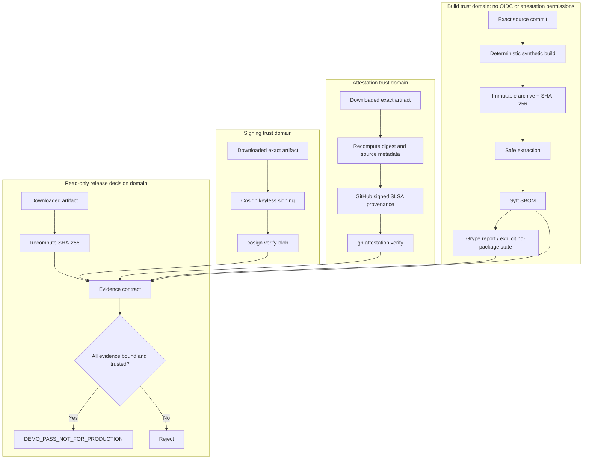

# Unified Release Assurance Implementation

| Field | Value |
|---|---|
| Document ID | UAPPSEC-SSC-IMPL-URA-001 |
| Status | Implementation baseline under validation |
| Version | 0.1 |
| Classification | Public |
| Scope | Synthetic training fixture only |
| Parent | [Chapter 13 Software Supply-Chain Security](../../../docs/13-software-supply-chain-security/SOFTWARE-SUPPLY-CHAIN-SECURITY-ENGINEERING.md) |

## 1. Purpose and assurance objective

The preceding Chapter 13 work demonstrated source integrity, SBOM generation, report-only software composition analysis (SCA), OpenVEX validation, GitHub-signed SLSA provenance and Cosign keyless blob signing as separate capabilities. This implementation composes the evidence into one release decision.

The objective is not to generate another JSON file and call it assurance. The workflow must establish that each required evidence item refers to the same immutable artifact, was produced or verified in the same workflow run, and satisfies explicit source and signer identity constraints. The final policy engine fails closed when evidence is missing, altered, mismatched, untrusted or structurally invalid.

The current implementation is deliberately limited to a deterministic synthetic training artifact. A successful result is named `DEMO_PASS_NOT_FOR_PRODUCTION`; it never authorizes production promotion.

## 2. Scope and trust boundaries

In scope:

- One deterministic synthetic archive and its SHA-256 identity.
- CycloneDX 1.7 SBOM generated from the extracted archive contents.
- Grype report generation when the SBOM contains package records.
- Explicit no-package disposition when no package records exist.
- GitHub-signed SLSA v1 provenance with signer, repository, source ref and source digest verification.
- Cosign keyless blob signing and exact identity/issuer/source-claim verification.
- Evidence-file digest checks and same-run/same-attempt checks.
- A fail-closed policy decision and machine-readable report.

Out of scope:

- Production application compilation or deployment.
- Production release signing keys, deployment credentials or privileged environments.
- A production SCA severity threshold or risk-exception workflow.
- Product-specific VEX decisions.
- A claim that the workflow meets SLSA Build L2 or L3.
- Independent builder assessment or production runner hardening assurance.

### Trust boundaries



The build job receives only `contents: read`. The attestation and signing jobs receive short-lived OIDC permissions only for their respective operations. The final policy job has no signing or deployment permission. Job separation reduces privilege exposure but does not, by itself, prove a SLSA Build level.

## 3. Evidence contract

The manifest is an index and decision input. It is not a substitute for the original evidence documents or cryptographic verification.

| Evidence | Required binding | Independent verification |
|---|---|---|
| Artifact | SHA-256 recomputed from downloaded bytes | Python standard-library SHA-256 |
| SBOM | Exact artifact SHA-256, SBOM document SHA-256, generation scope | Syft output plus structural validator |
| SCA | Exact artifact SHA-256 and exact SBOM document SHA-256 | Grype report plus report validator |
| SLSA | Artifact subject digest, source repository/ref/revision, signer workflow, OIDC issuer, predicate | `gh attestation verify` |
| Cosign | Artifact subject digest, certificate identity, OIDC issuer and source claims | `cosign verify-blob` |

All four evidence records must carry the same GitHub run ID and run attempt. The verifier hashes every evidence file after download and rejects path traversal, symlinks, missing files and digest mismatch.

### Empty inventory semantics

A synthetic archive may contain no recognized package records. In that case Grype is not run and the record must state `not_run_no_package_records` and `not_evaluated_no_package_records`. The policy must not convert an empty inventory into a zero-vulnerability claim. Production policy must decide whether an empty inventory is plausible for the target artifact and whether a scan is mandatory.

## 4. Policy decision semantics

| Condition | Result |
|---|---|
| All evidence valid and digest-consistent | `DEMO_PASS_NOT_FOR_PRODUCTION` |
| Artifact or evidence file digest mismatch | Reject |
| Missing required evidence | Reject |
| SBOM/SCA subject mismatch | Reject |
| SCA report refers to a different SBOM | Reject |
| Untrusted provenance workflow or issuer | Reject |
| Untrusted Cosign identity or issuer | Reject |
| Source repository/ref/revision mismatch | Reject |
| Evidence from another run or attempt | Reject |
| Empty inventory represented as clean | Reject |
| Unsupported release classification | Reject |

A demonstration pass is not a production approval. The report always sets `promotion_authorized: false`.

## 5. Local execution

From the repository root:

```bash
python3 -m unittest discover \
  -s implementations/13-software-supply-chain-security/unified-release-assurance \
  -p 'test_*.py' -v
```

The workflow produces the manifest from the actual downloaded run artifacts. Do not hand-edit a manifest to simulate successful cryptographic verification. The workflow must run `gh attestation verify` and `cosign verify-blob` first and only then create the corresponding verified records.

## 6. Negative test coverage

The unit suite covers artifact tampering, missing SBOM/provenance/signature, mismatched subjects, SCA-to-SBOM mismatch, untrusted signer identity, incorrect issuer, incorrect source revision, evidence-file tampering, path traversal, cross-run evidence and false clean claims for an empty inventory.

The workflow separately exercises real cryptographic rejection for tampered artifacts and identity/source mismatches through GitHub CLI and Cosign. Unit tests of the policy engine do not replace those cryptographic tests.

## 7. Operational controls and future production profile

Before adapting this prototype to a real product:

1. Identify the actual build system, source repositories, package managers and release artifact formats.
2. Build the real application once and pass the immutable output between jobs; never rebuild separately for signing or scanning.
3. Generate the SBOM from the exact artifact or its verified extracted contents and bind it to the artifact digest with a signed attestation or equivalent verifiable relationship.
4. Scan the actual SBOM with a current vulnerability database; retain database metadata, package count, match count and scanner configuration.
5. Define severity thresholds, exploitability/reachability treatment, KEV policy, VEX review, time-bound exceptions and approval roles.
6. Verify provenance against an approved builder identity and the complete expected source/materials/build definition.
7. Verify signatures and attestations at the deployment boundary, not only in CI.
8. Configure GitHub rulesets, protected environments, deployment identity and cloud admission separately; read back and test effective settings.
9. Define evidence retention, access control, revocation, incident handling and rollback.
10. Independently assess the builder and workflow threat model before making any SLSA level claim.

## 8. Standards and control traceability

The implementation is a technical demonstration and not a compliance assertion.

| Source / control family | Relationship | Evidence in this implementation | Limitation |
|---|---|---|---|
| SLSA v1.2 Build provenance | Direct implementation evidence for signed provenance subject and verification | GitHub attestation bundle and verifier output | Synthetic build only; no Build L2/L3 claim |
| SLSA Source track | Supporting | Exact repository, ref and source revision captured | Does not establish Source track requirements |
| NIST SSDF SP 800-218 v1.1 | Supporting | Protected build inputs, provenance and release integrity themes | Full practice-to-evidence mapping remains in Chapter 13 |
| CycloneDX 1.7 / SPDX 2.3 | Direct format usage | Generated SBOM and document digest | This workflow currently validates CycloneDX output; full schema conformance remains a separate gate |
| NIST SP 800-218 PW.4 / PS.2 themes | Supporting | Release integrity and component inventory evidence | Mapping is indicative; not a clause-level compliance result |
| Sigstore / Cosign | Direct tool use | Keyless signature bundle and identity verification | Production signing governance not assessed |
| GitHub artifact attestations | Direct service use | Signed SLSA attestation and signer workflow checks | GitHub platform trust and account configuration remain external dependencies |

Exact control IDs are retained in the Chapter 13 control traceability register. Do not infer a new control ID from this implementation folder.

## 9. Limitations and review requirements

- GitHub CLI and Cosign perform the cryptographic checks. The Python policy engine validates the resulting evidence contract and file digests; it does not implement Sigstore cryptography.
- A compromised trusted workflow or repository administrator remains within the trust model and requires governance controls beyond this script.
- A manifest created by an untrusted process is not trustworthy merely because it is valid JSON. Only the protected workflow may produce verified status records after successful verifier commands.
- The current SCA result is report-only. No severity threshold is enforced.
- Empty package inventory is not a clean security result.
- No production promotion or deployment occurs.
- No SLSA level is claimed.

## 10. References

- GitHub, Artifact attestations: https://docs.github.com/en/actions/security-for-github-actions/using-artifact-attestations
- GitHub CLI, `gh attestation verify`: https://cli.github.com/manual/gh_attestation_verify
- SLSA, Build track: https://slsa.dev/spec/v1.2/build-track
- SLSA, Provenance: https://slsa.dev/spec/v1.2/provenance
- Sigstore, Cosign verification: https://docs.sigstore.dev/cosign/verifying/verify/
- Syft documentation: https://oss.anchore.com/docs/
- Grype documentation: https://oss.anchore.com/docs/

## 11. Revision history

| Version | Date | Change | Status |
|---|---|---|---|
| 0.1 | 2026-11-26 | Initial unified evidence contract, fail-closed validator, synthetic policy and test suite authored | Implementation baseline under validation |
